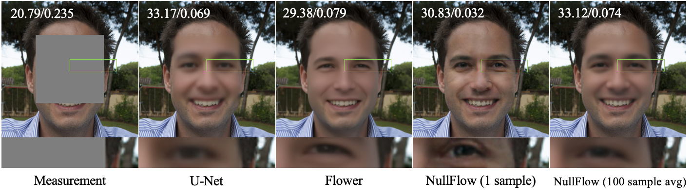

# NullFlow

Reference implementation of **NullFlow**, a **one-step generative reconstruction** method for linear inverse problems. By restricting the generative flow to the **measurement-consistent subspace**, NullFlow preserves measurement consistency by construction without requiring iterative data-fidelity corrections. Built on **MeanFlow**, it learns the average velocity of a null-space-constrained flow, enabling posterior sampling with a single network evaluation. NullFlow achieves competitive reconstruction quality against iterative diffusion and flow-based solvers on **image inpainting and accelerated MRI**, while reducing inference from hundreds of network evaluations to just one.

<p align="center">
  
</p>

## Method

We consider noiseless linear measurements $y = Ax$ with an ill-posed $A$, i.e. $\mathrm{null}(A) \neq \{0\}$. Any image
decomposes into a row-space and a null-space component,

```math
x = \underbrace{A^{\dagger}A\,x}_{\text{row space}} + \underbrace{(I - A^{\dagger}A)\,x}_{\text{null space}},
\qquad P := I - A^{\dagger}A ,
```

where $A^{\dagger}$ is the pseudo-inverse of $A$ and $P$ the orthogonal projection onto $\mathrm{null}(A)$. The measurement fixes the
row-space component, and every measurement-consistent image lies in the affine subspace

```math
\mathcal{M}_y := \{\, x : Ax = y \,\}.
```

NullFlow learns a one-step MeanFlow that stays entirely within $\mathcal{M}_y$ and samples from the conditional image
distribution $p(x \mid y)$.

### Subspace-restricted flow matching

The flow transports between two distributions supported on $\mathcal{M}_y$. The source is $x_1 \sim q(\cdot \mid y)$ with
$x_1 = A^{\dagger}y + Pz$ and $z \sim \mathcal{N}(0, I)$: the row-space component is pinned to the least-squares estimate
$A^{\dagger}y$ and the null space is filled with Gaussian noise. The target is $x_0 \sim p(\cdot \mid y)$. The conditional path
toward $x_0$ is Gaussian with covariance confined to $\mathrm{null}(A)$,

```math
p_t(x \mid x_0, y) = \mathcal{N}\big(x \,\big|\, \mu_t(x_0, y),\ \sigma_t^2(x_0)\,P\big),
\qquad
\mu_t(x_0, y) = \big(1 - (1 - \sigma_{\min})\,t\big)\,P x_0 + A^{\dagger}y,
\qquad
\sigma_t(x_0) = t ,
```

so that $p_1 = q(\cdot \mid y)$ and $p_0$ concentrates at $x_0$. It is realized by the conditional flow

```math
\psi_t(x \mid y) = t\,P x + \big(1 - (1 - \sigma_{\min})\,t\big)\,P x_0 + A^{\dagger}y ,
```

which moves the null-space content from $Px$ to $Px_0$ while holding the anchor $A^{\dagger}y$ fixed. Its velocity field

```math
v_t(x \mid y) = P\big(x - (1 - \sigma_{\min})\,x_0\big) \in \mathrm{null}(A)
```

lies in the null space, so a step along it preserves $Ax = y$: every state of the flow is measurement-consistent, with
no separate data-fidelity step.

### One-step sampling via MeanFlow

Instead of integrating $v_t$ from $t = 1$ to $t = 0$, NullFlow learns the average velocity between two times $r \le t$,

```math
u_{r,t}(x_t \mid y) := \frac{1}{t - r} \int_r^t v_\tau(x_\tau \mid y)\, d\tau ,
```

which allows a single jump from the source to the data. Differentiating in $t$ gives the MeanFlow identity on $\mathcal{M}_y$,

```math
u_{r,t}(x_t \mid y) = v_t(x_t \mid y) - (t - r)\,\frac{d}{dt}\, u_{r,t}(x_t \mid y) ,
```

which involves only $v_t$ and a derivative of $u_{r,t}$, both available without integration. Following Pixel MeanFlow, the
network $x^{\theta}_{r,t}$ predicts the clean image and the average velocity is $u^{\theta}_{r,t}(z_t \mid y) = \big(z_t - x^{\theta}_{r,t}(z_t)\big)/t$.
It is trained with

```math
\mathcal{L}_{\mathrm{PMF}} := \mathbb{E}_{r,t,x,y,\epsilon}\,
\big\| V^{\theta}_{r,t}(x_t \mid y) - (\epsilon - x) \big\|_2^2 ,
\qquad
V^{\theta}_{r,t}(x_t \mid y) := u^{\theta}_{r,t}(x_t \mid y) + (t - r)\,\mathrm{sg}\Big[\tfrac{d}{dt}\, u^{\theta}_{r,t}\Big],
```

where $z_t = t\,P\epsilon + (1 - t)\,P x + A^{\dagger}y$, the time derivative is a forward-mode JVP along the instantaneous velocity, and
$\mathrm{sg}$ is the stop-gradient. A zero loss enforces the MeanFlow identity, so $u^{\theta}_{0,1}$ is a one-step sampler of
$p(x \mid y)$.

**Sampling** evaluates the network once:

```math
\hat{x} = A^{\dagger}y + P\, x^{\theta}_{0,1}\big(A^{\dagger}y + P\epsilon\big),
\qquad \epsilon \sim \mathcal{N}(0, I).
```

Each draw is a posterior sample. Averaging $M$ draws for the same $y$ estimates the posterior mean $\mathbb{E}[x \mid y]$: one
draw gives the best perceptual quality (LPIPS), and averaging trades it for distortion (PSNR, SSIM). That is the gap
between the one-draw and the averaged rows in the tables below.

### Implementation notes

- **Operators.** Inpainting uses $A = \mathrm{diag}(M)$ for a pixel mask $M$, so $A^{\dagger}y = My$ and $P = \mathrm{diag}(1 - M)$. MRI uses
  $A = MFS$ (Cartesian mask, Fourier transform, coil sensitivities), with $A^{\dagger}$ applied as $(A^{H}A + \lambda I)^{-1}A^{H}$,
  $\lambda = 10^{-8}$, by conjugate gradient (at most 200 iterations).
- **Network input.** The network sees $[z_t,\ c(y)]$ and is conditioned on $(r, t)$, with $c(y) = A^{H}y$ for MRI and
  $c(y) = [A^{H}y,\ M]$ for inpainting. We use $\sigma_{\min} = 0$.
- **Training details.** The $(t, r)$ sampling and the adaptive loss weight are fixed in `nullflow/nullflow.py`.
- **Evaluation.** `evaluate.py` scores the network output $x^{\theta}_{0,1}$. For inpainting, `--restore` applies the final
  projection $A^{\dagger}y + P(\cdot)$.

## Tasks

| Task (`run.sh`) | Config | Released weights | Network |
|---|---|---|---|
| `brain_r4` | `configs/brain.yaml` | `nullflow_brain_R4.pt` (epoch 60) | 40.7M, input 4 channels |
| `brain_r8` | `configs/brain.yaml` with `mri.acceleration=8` | `nullflow_brain_R8.pt` (epoch 60) | 40.7M, input 4 channels |
| `ffhq_box` | `configs/ffhq_box.yaml` | `nullflow_ffhq_box.pt` (epoch 75) | 110.5M, input 7 channels |
| `ffhq_random` | `configs/ffhq_random.yaml` | `nullflow_ffhq_random.pt` (epoch 100) | 110.5M, input 7 channels |

## Results

**fastMRI brain** (AXT2, multi-coil, 320 × 320), noiseless, fixed random Cartesian mask. Test set: 100 slices
from 77 test volumes (`data_splits/brain/test100.txt`).

| Draws averaged | R = 4: PSNR / SSIM / LPIPS | R = 8: PSNR / SSIM / LPIPS | Time per slice |
|---|---|---|---|
| 1 | 33.54 / 0.903 / 0.049 | 29.95 / 0.854 / 0.106 | 0.08 s |
| 100 | 34.09 / 0.921 / 0.054 | 30.33 / 0.865 / 0.108 | 9.80 s |

All metrics are on the magnitude image, with each slice's maximum as its data range:
- **PSNR**
- **SSIM:** torchmetrics, Gaussian window 11, σ 1.5
- **LPIPS:** AlexNet

Timing is on one NVIDIA RTX PRO 6000 (Blackwell), one slice at a time. Of the 0.08 s for one draw, the CG
pseudo-inverse takes 0.06 s and the network 0.02 s.

**FFHQ 256 × 256 inpainting**, noiseless. Test set: images 00000–00499.

| Draws averaged | Box: PSNR / SSIM / LPIPS | Random: PSNR / SSIM / LPIPS | Time per sample |
|---|---|---|---|
| 1 | 24.42 / 0.887 / 0.070 | 31.14 / 0.897 / 0.033 |0.011 s|
| 100 | 26.72 / 0.908 / 0.086 | 32.16 / 0.911 / 0.075 |0.981 s|

## Installation

```bash
conda create -n nullflow python=3.11 && conda activate nullflow
pip install torch torchvision          # a CUDA build that matches your GPU
pip install -r requirements.txt
```

## Data

### fastMRI brain

**Download.** Get the fastMRI brain `multicoil_val` release (Zbontar et al., 2018; Knoll et al., 2020) from
https://fastmri.med.nyu.edu/. Every volume used here comes from it:
- 615 training volumes (4,305 slices)
- 77 validation volumes
- 77 test volumes

The split is in `data_splits/brain/index_AXT2_320.json`.

**Build the cache.** This step needs sigpy for ESPIRiT. It takes about 30 s per volume per worker, about 6
CPU-hours in total:

```bash
python scripts/build_cache.py --fastmri_dir /path/to/brain/multicoil_val --out data/cache320 --workers 8
```

For each slice, the script computes ESPIRiT maps at the acquired field of view and centre-crops both the coil
images and the maps to 320 × 320. It then stores the coil-combined image x0 = Σ_c conj(S_c) c_c and the maps.

**At load time**, each slice is divided by max |x0|, and its maps are zero-padded to 20 coils.

### FFHQ

**Download.** Get FFHQ (Karras et al., 2019) from https://github.com/NVlabs/ffhq-dataset.

Put the 70,000 FFHQ images at 256 × 256 in one folder, named `00000.png` … `69999.png`. The default location is
`data/ffhq256`. Images of another size are resized bilinearly when they are loaded.

The splits are index ranges, set in the config:
- train: 01000–69999
- val: 00500–00999
- test: 00000–00499

**Masks:**
- **Box:** a fixed centred 128 × 128 hole.
- **Random:** exactly 70 % of the pixels are removed, independently for each image. For evaluation, the mask of
  test image i is drawn from a seeded generator, so every run scores the same masks.

## One launcher for every task

`run.sh` drives training, checkpoint selection, export and evaluation:

```bash
./run.sh <task> <mode> [args]
#   tasks: brain_r4 | brain_r8 | ffhq_box | ffhq_random
#   modes: train | resume <checkpoint> | select [run dir] | export <checkpoint> | eval [checkpoint]
```

Any extra arguments are passed on to `train.py` / `evaluate.py`, after the task's defaults, so they override them.

Settings come from environment variables:

| Variable | Default | Meaning |
|---|---|---|
| `GPUS` | `0` | Training runs one process per listed GPU; `select` and `eval` use the first |
| `BACKEND` | `nccl` | torch.distributed backend for multi-GPU training; use `gloo` if NCCL fails |
| `PYTHON` | `python` | Python interpreter |
| `FASTMRI_CACHE` | `data/cache320` | fastMRI cache |
| `FFHQ_ROOT` | `data/ffhq256` | FFHQ image folder |
| `RUNS` | `runs` | Training runs |
| `CKPTS` | `checkpoints` | Released weights |
| `OUT` | | Output folder of this call |

To keep machine-specific values in one place, write them to a `local.env` next to `run.sh`, for example
`: "${FFHQ_ROOT:=/data/ffhq256}"`. `run.sh` sources it first, and `local.env` is git-ignored.

```bash
./run.sh brain_r4 eval                                   # test100, M = 1 and 16, with LPIPS
./run.sh ffhq_box eval                                   # test500, M = 1, 4, 16 and 100, with LPIPS
./run.sh ffhq_random eval --M 1 16 --n 100 --restore     # first 100 test images, observed pixels pasted back
OUT=results/box ./run.sh ffhq_box eval                   # also save per-image metrics and PNGs
GPUS=0,1,2,3 ./run.sh ffhq_box train                     # train on 4 GPUs into runs/ffhq_box
./run.sh ffhq_box select                                 # one-draw val PSNR of every checkpoint in runs/ffhq_box
./run.sh ffhq_box export runs/ffhq_box/checkpoints/epoch_0075.pt   # -> checkpoints/nullflow_ffhq_box.pt
```

## Pretrained models

Download the released weights from Hugging Face ([xiaoshi2610/NullFlow](https://huggingface.co/xiaoshi2610/NullFlow)) into `checkpoints/`:
`hf download xiaoshi2610/NullFlow --local-dir checkpoints` (after `pip install -U huggingface_hub`).

| File | Size | sha256 |
|---|---|---|
| `nullflow_brain_R4.pt` | 163 MB | `ae56437cdc1f1cee9f5c4b62475e20e115fd91c8ab650ab4504cc46101148a61` |
| `nullflow_brain_R8.pt` | 163 MB | `ad4c766d8d47e558617fe09f679dd46c158e56e497b4e95790fa0ed4d30849e9` |
| `nullflow_ffhq_box.pt` | 442 MB | `b9198d95ab784de96303c77e1c43e2c615f3a5282f4f0bd370873df85a91a3c5` |
| `nullflow_ffhq_random.pt` | 442 MB | `48ce83acbf96f6e700d83ea65887bdcad840f1803973b980210c8ec294a6e149` |

`./run.sh <task> eval` runs these commands:

```bash
python evaluate.py --config configs/brain.yaml --ckpt checkpoints/nullflow_brain_R4.pt \
    --split test --ids data_splits/brain/test100.txt --M 1 16 --lpips
python evaluate.py --config configs/brain.yaml --ckpt checkpoints/nullflow_brain_R8.pt --set mri.acceleration=8 \
    --split test --ids data_splits/brain/test100.txt --M 1 16 --lpips
python evaluate.py --config configs/ffhq_box.yaml --ckpt checkpoints/nullflow_ffhq_box.pt --split test --M 1 4 16 100 --lpips
python evaluate.py --config configs/ffhq_random.yaml --ckpt checkpoints/nullflow_ffhq_random.pt --split test --M 1 4 16 100 --lpips
```

## Train

```bash
GPUS=0,1,2,3 ./run.sh brain_r4 train      # = torchrun --nproc_per_node=4 train.py --config configs/brain.yaml --out runs/brain_r4
GPUS=0,1,2,3 ./run.sh brain_r8 train
GPUS=0,1,2,3 ./run.sh ffhq_box train
GPUS=0,1,2,3 ./run.sh ffhq_random train
./run.sh ffhq_box resume runs/ffhq_box/checkpoints/epoch_0040.pt     # continue a run
```

`resume` restores the weights, the optimizer and the lr state. It reads the run's own `config.yaml` when the run
directory has one.

`training.batch_size` is the global batch. Each GPU runs `training.micro_batch` samples per forward pass and
accumulates gradients up to the global batch, so the schedule does not depend on the GPU count. A
checkpoint is saved every 5 epochs.

**MRI:**
- 100 epochs
- global batch 16
- AdamW at lr 1e-4 with cosine decay to 1e-6, weight decay 1e-4, gradient clipping at 1

**FFHQ:**
- 100 epochs; an epoch is one pass over the 69,000 training images, with random horizontal flips
- global batch 512, as 4 images per GPU with gradient accumulation
- AdamW (β = 0.9, 0.95) at a constant lr 1e-4, no weight decay, gradient clipping at 1, dropout 0.1
- adaptive loss weight normalized by a running mean of the residual
- validation: one-draw PSNR on the 500 validation images after every epoch. The lr is multiplied by 0.1 once,
  after validation PSNR first reaches 23 dB on two consecutive epochs.

**Checkpoint selection.** We pick the checkpoint with the highest one-draw PSNR on the validation split:
- MRI: the 20 validation slices. Epoch 60 was selected at both R = 4 and R = 8.
- FFHQ: the 500 validation images. Epoch 100 was selected for random. For box, epochs 70 and 75 tied
  (24.2143 against 24.2137 dB), and epoch 75 was taken for its lower validation LPIPS.

```bash
./run.sh brain_r4 select runs/brain_r4      # = evaluate.py --split val --ids data_splits/brain/val20.txt --M 1 over every checkpoint
./run.sh brain_r4 export runs/brain_r4/checkpoints/epoch_0060.pt
```

## Layout

| Path | Contents |
|---|---|
| `run.sh` | One launcher: train / resume / select / export / eval for every task |
| `nullflow/mri.py` | Forward model A = M F S, its adjoint, Cartesian mask, CG pseudo-inverse |
| `nullflow/inpainting.py` | Forward model A = diag(mask), box and random masks, elementwise pseudo-inverse |
| `nullflow/nullflow.py` | Null-space source, MeanFlow loss (JVP), one-step and M-draw sampling |
| `nullflow/unet.py` | The network: a UNet conditioned on t, r and the noise level |
| `nullflow/data.py` | fastMRI brain dataset over the cache, FFHQ dataset |
| `nullflow/metrics.py` | PSNR / SSIM / LPIPS on MRI magnitude images and on RGB images |
| `nullflow/config.py` | Builds the operator, model and dataset of a config |
| `train.py`, `evaluate.py` | Training (1 or more GPUs) and evaluation |
| `scripts/build_cache.py` | fastMRI → 320 × 320 cache with ESPIRiT maps |
| `scripts/export_weights.py` | Training checkpoint → weights-only file |
| `configs/` | All settings: `brain.yaml`, `ffhq_box.yaml`, `ffhq_random.yaml` |
| `data_splits/brain/` | Volume split, validation / test slice ids and their (volume, slice) provenance |

## Citation

_To be added._
