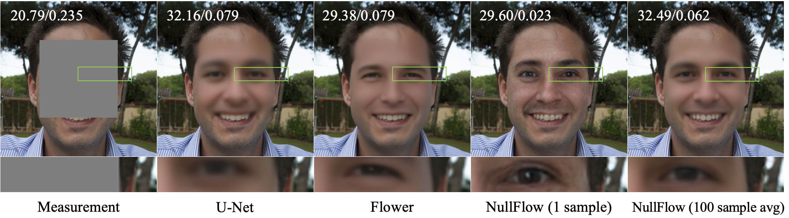

# NullFlow
[arXiv](https://arxiv.org/abs/2606.22696)


## Abstract

We propose NullFlow, a principled framework for one-step generative image reconstruction. Our key idea is to confine the generative flow to a measurement-consistent subspace. Because the flow never leaves this subspace, NullFlow needs no separate data-fidelity corrections, unlike existing solvers. NullFlow samples in a single network evaluation by learning the flow's average velocity, avoiding the step-by-step integration of traditional flow matching methods. We prove that the average velocity of this constrained flow yields a training objective whose global minimizer is a one-step posterior sampler. We show on image inpainting that NullFlow matches state-of-the-art diffusion solvers while cutting inference from hundreds of network evaluations to one.

## Setup

### 1) Clone the repository
```bash
git clone https://github.com/uw-cig/NullFlow.git
cd NullFlow
```
### 2) Download Pretrained Model

### 3) Virtual environment setup

```bash
conda create -n nullflow python=3.12 pip
conda activate nullflow
pip install -r requirements.txt
```

## Configs

The formal FFHQ 256x256 inpainting presets are:

- `configs/ffhq256_inpainting.yaml`: training preset.
- `configs/ffhq256_inpainting_infer.yaml`: inference preset.

Set `data.data_root` to the FFHQ image directory in both files. For inference,
set `training.load_from` in `configs/ffhq256_inpainting_infer.yaml` to the
checkpoint path generated by training.

### 1) Training

The root script delegates to `NullFlow.training.train`; all training behavior is
configured through YAML.

```bash
CONFIG_PATH=configs/ffhq256_inpainting.yaml \
DEVICE=cuda:0 \
./train.sh
```

For DDP training:

```bash
CONFIG_PATH=configs/ffhq256_inpainting.yaml \
NPROC_PER_NODE=4 \
./train.sh
```

### 2) Inference

Set `training.load_from` in the YAML file to the checkpoint path, then run:

```bash
CONFIG_PATH=configs/ffhq256_inpainting_infer.yaml \
DEVICE=cuda:0 \
./infer.sh
```

Inference writes metrics and a reconstruction grid under
`<output_dir>/solve/<checkpoint_name>/`.

Each inference output directory contains:

- `grid.png`: ground truth, measurement, null-space estimate, reconstruction.
- `metrics.json`: averaged reconstruction metrics.
- `metadata.json`: evaluation metadata.

### 3) Visualization

```bash
python -m NullFlow.utils.render_result \
  --solve-dir outputs/nullflow_ffhq/solve/epoch_075 \
  --output outputs/summary.png
```

The visualizer expects the inference directory to contain `grid.png` and, when
available, `metrics.json`.

## Implementation detail

```text
  train.sh                                      # Launch training with the selected config
  infer.sh                                      # Run inference from a trained checkpoint

  configs/
  ├── ffhq256_inpainting.yaml                   # Training config for FFHQ inpainting
  └── ffhq256_inpainting_infer.yaml             # Inference config with checkpoint path

  NullFlow/
  ├── training/train.py                         # Read config / initialize data, model, optimizer / run training
  ├── evaluation/solve.py                       # Read config / load checkpoint / run one-step inpainting inference
  ├── utils/render_result.py                    # Render inference grid and metrics for visualization
  ├── data/ffhq.py                              # FFHQ dataset loading and split handling
  ├── inverse/deepinv_inpainting.py             # Build inpainting forward operator
  ├── model/pmf_adapter.py                      # Initialize NullFlow PMF model wrapper
  └── model/unet_pmf.py                         # UNet backbone for PMF velocity prediction

  guided_diffusion/
  └── unet.py                                   # Guided-diffusion UNet components used by NullFlow
```

## Troubleshooting
If you encounter any issues, feel free to reach out via email at xiao.shi@wisc.edu. 

## Citation
If you find our work useful, please consider citing

```bibtex
@article{shi2026nullflow,
  title={NullFlow: One-Step Generative Reconstruction},
  author={Shi, Xiao and Chandler, Edward P and Park, Chicago Y and Shoushtari, Shirin and Kamilov, Ulugbek S},
  journal={arXiv preprint arXiv:2606.22696},
  year={2026}
}
```
